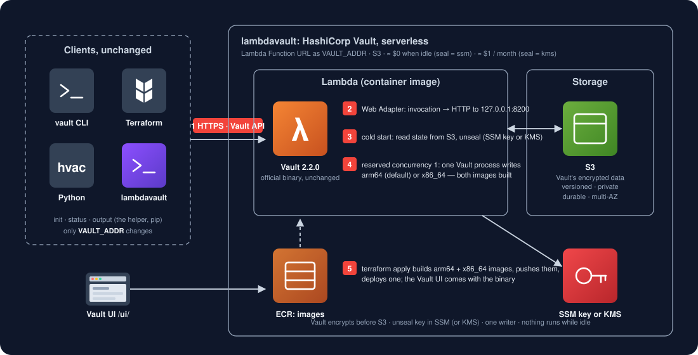

# lambdavault — HashiCorp Vault, truly serverless

> A self-managed **Vault** means servers that run all day (three for HA); **HCP Vault** starts around
> $450 a month. **lambdavault** runs the official Vault binary, unchanged, inside **AWS Lambda**, with its
> data in **S3** and its unseal key in **SSM Parameter Store**: ≈ $0 when idle (or auto-unseal by **KMS**, ≈ $1 a
> month for the key). The vault CLI, the Terraform vault
> provider, the UI and hvac talk to it as to any Vault — only `VAULT_ADDR` changes (hvac: except
> `list`, [task 5](tests/compat/TASKS.md)).

[中文](README.zh.md) · [compatibility report](tests/compat/REPORT.md) · [tasks](tests/compat/TASKS.md) · [changelog](CHANGELOG.md)



| | Vault on EC2 (self-managed) | HCP Vault Dedicated | lambdavault |
|---|---|---|---|
| Idle cost / month | the instances (3 for HA), load balancer, disks | ≈ $450 (Development) · ≈ $1,150+ (Essentials) | ≈ $0 (`seal = ssm`) · ≈ $1 (`seal = kms`, the KMS key) |
| Runs | Vault Community on your instances | Vault Enterprise, by HashiCorp | Vault Community 2.2.0 in Lambda |
| Storage | Raft on the instances' disks | HashiCorp's cloud | S3 in your account (versioned), Vault-encrypted |
| Unseal | manual or KMS | managed | at every cold start, automatically: the key from SSM (`ssm`) or KMS (`kms`) |
| Endpoint | your load balancer | HCP | Lambda Function URL (HTTPS) |
| Clients | vault CLI, hvac, Terraform provider | the same | the same, unchanged (hvac `list`: task 5) |
| Console | Vault UI | Vault UI | Vault UI (`<vault_addr>/ui/`) |
| Compatibility | — | — | [see the report](tests/compat/REPORT.md) |

## Why

Most teams use Vault to keep static secrets and hand them to Terraform and applications a few times a day. That
needs a Vault that is always reachable, not one that is always running. Lambda runs Vault only while a request
is being answered; S3 keeps the state, SSM Parameter Store (or KMS) the key.

## How it works

`client/lambdavault/server/Dockerfile` is the official `hashicorp/vault` image plus AWS Lambda Web Adapter, which
turns each invocation into an HTTP request to Vault on `127.0.0.1:8200`. Vault's config
(`client/lambdavault/server/vault.hcl`) uses the `s3` storage backend, so a cold start reads its state from S3 and
is unsealed before the first request is let through (see [The seal](#the-seal)). The function's reserved
concurrency is 1: the s3 backend has no lock, so exactly one Vault process ever writes. The public URL belongs to a
small proxy Lambda (`client/lambdavault/proxy`) that queues concurrent callers for that one Vault instead of letting
Lambda refuse them with 429. Both ship in the pip package, so a deployment comes from a PyPI release: the
Terraform module [`cloudformer/infra/aws//modules/lambdavault`](https://github.com/cloudformer/terraform-aws-infra/tree/main/modules/lambdavault)
stages `lambdavault==<version>`, builds the image for arm64 and x86_64 with Docker, pushes both to ECR and deploys
one (`architecture`, default arm64).

## The seal

Vault must be unsealed after every cold start. `seal` (in your variable file) picks how:

| `seal` | Idle cost | At a cold start | Initialize with |
|---|---|---|---|
| `ssm` (default) | free | Shamir seal, one key share. The key is an SSM SecureString `/<project_name>/unseal-key` (AWS's `aws/ssm` key, standard tier); the Vault function's start script (`entrypoint.sh`) reads it and unseals Vault | `vault operator init -key-shares=1 -key-threshold=1`: the proxy writes the key to SSM and unseals the running Vault |
| `kms` | ≈ $1 / month | Vault's `awskms` seal with a KMS key (`alias/<project_name>-seal`): Vault unseals itself | `vault operator init -recovery-shares=1 -recovery-threshold=1` |

- **Do not switch `seal` on a deployed vault without a seal migration** (`vault operator unseal -migrate`): the
  data is sealed one way or the other. Choose before the first init.
- Fails closed: a key that cannot be read (parameter missing, no permission) leaves Vault sealed and every request
  gets an error, never an open vault. `aws ssm put-parameter --name /<project_name>/unseal-key --type SecureString
  --value <Unseal Key 1> --overwrite` puts it back.
- The parameter is written at init, not by Terraform: the key is never in the Terraform state, and `destroy`
  leaves it (delete it with `aws ssm delete-parameter` once the data is gone for good).

## Quick start

### 1. Deploy

Needs Terraform ≥ 1.10, python3 with pip, and Docker running (apply builds and pushes the image). `terraform/`
calls the Registry module; its usage and variables are documented once, in the
[module README](https://github.com/cloudformer/terraform-aws-infra/tree/main/modules/lambdavault).

```bash
cp terraform/example.json terraform/my.json      # set aws_profile, region, project_name, seal
terraform -chdir=terraform init
terraform -chdir=terraform apply -var-file=my.json
terraform -chdir=terraform output                 # vault_addr, ui_url
```

### 2. Initialize once

```bash
export VAULT_ADDR=$(terraform -chdir=terraform output -raw vault_addr)
vault operator init -key-shares=1 -key-threshold=1   # seal = ssm: prints the root token and unseal key once: keep both
# seal = kms:   vault operator init -recovery-shares=1 -recovery-threshold=1
export VAULT_TOKEN=<root token>
vault status
```

### 3. Use it as any Vault

```bash
vault secrets enable -path=kvv2 kv-v2
vault kv put kvv2/app user=u password=p
vault kv get kvv2/app
```

```hcl
provider "vault" {
  address = "<vault_addr>"   # terraform output vault_addr
}

data "vault_kv_secret_v2" "app" {
  mount = "kvv2"
  name  = "app"
}
```

Open `<vault_addr>/ui/` in a browser for the Vault UI.

Concurrent callers (Terraform's parallel reads, the UI's assets) are queued by the proxy and served one after
another; a caller waits up to 25 s for its turn.

## Compatibility

Both sides run the same Vault binary, so the report checks that Vault on Lambda answers exactly like a normal
Vault: the same hvac calls on Vault 2.2.0 in Docker and on the deployed stack, compared step by step.

```bash
LAMBDAVAULT_TOKEN=<token> python3 -m pytest tests -q --docker run --aws my.json   # Vault in Docker vs the deployed lambdavault
python3 -m pytest tests -q                               # regression suite only
```

## Guarantees

| | How |
|---|---|
| **Encryption** | Vault's barrier encrypts every value before it reaches S3 (S3 adds SSE-S3); the unseal key is an SSM SecureString (`ssm`), or Vault's root key is wrapped by KMS (`kms`) |
| **Fail closed** | a Vault that cannot be unsealed stays sealed: the readiness check never passes and callers get an error |
| **Durability** | S3 (versioned: an overwritten object can be recovered) |
| **One writer** | reserved concurrency 1: two Vault processes never share the storage |
| **Availability** | Lambda, S3, SSM and KMS are regional, multi-AZ: no instance to fail or patch |

## Who this is for

Teams that use Vault for static secrets (KV), tokens, policies and auth methods such as userpass, at a few
requests per second (callers queue for the one Vault). Not for: high request rates, Raft / replication / Enterprise features.
See MIGRATION.md for moving to a Vault cluster.

## Repository layout

```
client/           the pip package lambdavault: status, output (optional helper), and what a deployment is built from:
  lambdavault/server/   Dockerfile (Vault + Lambda Web Adapter), vault.hcl, seal-awskms.hcl, entrypoint.sh (unseal)
  lambdavault/proxy/    the public entrance: queues callers for the one Vault; seal = ssm: stores the key at init
terraform/        calls the Registry module (modules/lambdavault): S3, ECR, the seal, the Vault Lambda, the proxy + URL
tests/            regression suite; tests/compat/ Vault vs lambdavault, REPORT.md, TASKS.md
```

## Releasing

CI runs the suite on every push. A release is a tag: bump the version in `client/pyproject.toml` and
`client/lambdavault/__init__.py`, add the CHANGELOG entry, commit, then `git tag vX.Y.Z && git push --tags`.

---

Part of **[IdleFree](https://cloudformer.github.io/)** — AWS services and self-hosted apps rebuilt to cost ≈ $0 when
idle. MIT. Vault is a trademark of HashiCorp; lambdavault
runs the unmodified Vault Community binary under its own license (BSL 1.1).
