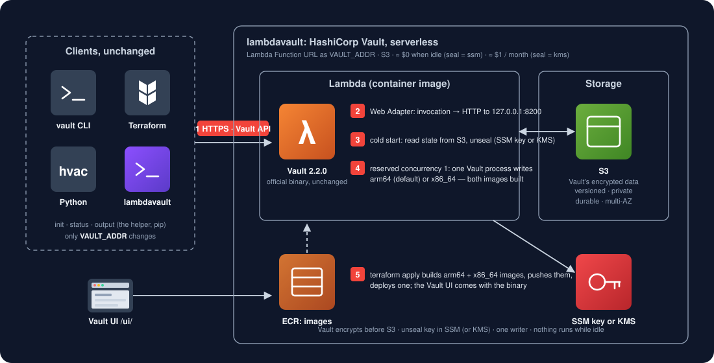

# lambdavault —— 真正 serverless 的 HashiCorp Vault

> 自己部署 **Vault** 意味着服务器全天开着（高可用要 3 台）；**HCP Vault** 每月约 $450 起。**lambdavault**
> 把官方 Vault 程序原样跑在 **AWS Lambda** 里，数据存在 **S3**，解封密钥存在 **SSM Parameter Store**：闲置约 $0
>（也可以改用 **KMS** 自动解封，KMS 密钥每月约 $1）。
> vault 命令行、Terraform 的 vault provider、UI 和 hvac 照常使用，只改 `VAULT_ADDR`（hvac 的 `list` 除外，见
> [task 5](tests/compat/TASKS.md)）。

[English](README.md) · [兼容性报告](tests/compat/REPORT.md) · [任务](tests/compat/TASKS.md) · [更新记录](CHANGELOG.md)



| | 自己部署在 EC2 | HCP Vault Dedicated | lambdavault |
|---|---|---|---|
| 闲置费用 / 月 | 实例（高可用 3 台）、负载均衡、磁盘 | 约 $450（开发档）· 约 $1,150 起（Essentials） | 约 $0（`seal = ssm`）· 约 $1（`seal = kms`，KMS 密钥） |
| 运行的是 | 你实例上的 Vault 社区版 | HashiCorp 托管的 Vault 企业版 | Lambda 里的 Vault 社区版 2.2.0 |
| 存储 | 实例磁盘上的 Raft | HashiCorp 的云 | 你账号里的 S3（开版本控制），Vault 加密 |
| 解封 | 手动或 KMS | 托管 | 每次冷启动自动解封：密钥来自 SSM（`ssm`）或 KMS（`kms`） |
| 地址 | 你的负载均衡 | HCP | Lambda Function URL（HTTPS） |
| 客户端 | vault CLI、hvac、Terraform provider | 一样 | 一样，不用改（hvac 的 `list`：task 5） |
| 控制台 | Vault UI | Vault UI | Vault UI（`<vault_addr>/ui/`） |
| 兼容性 | — | — | [见报告](tests/compat/REPORT.md) |

## 为什么

大多数团队用 Vault 存静态密钥，每天交给 Terraform 和应用读几次。这只需要一个随时能访问的 Vault，不需要一个
一直在运行的 Vault。Lambda 只在有请求时运行 Vault；状态存在 S3，密钥存在 SSM Parameter Store（或 KMS）。

## 原理

`client/lambdavault/server/Dockerfile` 是官方 `hashicorp/vault` 镜像加上 AWS Lambda Web Adapter：每次调用被转成一次发给
`127.0.0.1:8200` 上 Vault 的 HTTP 请求。Vault 的配置（`client/lambdavault/server/vault.hcl`）用 `s3` 存储后端，冷启动时从 S3
读取状态，并在第一个请求放进来之前完成解封（见[解封](#解封)）。函数的保留并发是 1：s3 存储后端没有锁，所以永远只有一个
Vault 进程在写。公开的 URL 属于一个小的代理 Lambda（`client/lambdavault/proxy`），它让并发的调用排队等待这一个 Vault，
而不是被 Lambda 直接以 429 拒绝。两者都在 pip 包里，所以部署来自 PyPI 上的发布版：Terraform 模块
[`cloudformer/infra/aws//modules/lambdavault`](https://github.com/cloudformer/terraform-aws-infra/tree/main/modules/lambdavault)
取 `lambdavault==<版本>`，用 Docker 为 arm64 和 x86_64 都构建镜像、都推到 ECR，部署其中一个（`architecture`，默认 arm64）。

## 解封

每次冷启动后 Vault 都必须先解封。变量文件里的 `seal` 决定怎么解封：

| `seal` | 闲置费用 | 冷启动时 | 初始化命令 |
|---|---|---|---|
| `ssm`（默认） | 免费 | Shamir 解封，只有一份密钥。密钥是 SSM SecureString `/<project_name>/unseal-key`（AWS 自带的 `aws/ssm` 密钥，标准层）；Vault 函数的启动脚本（`entrypoint.sh`）读取它并解封 Vault | `vault operator init -key-shares=1 -key-threshold=1`：代理把密钥写进 SSM，并解封正在运行的 Vault |
| `kms` | 每月约 $1 | Vault 的 `awskms` 解封，用一个 KMS 密钥（`alias/<project_name>-seal`）：Vault 自己解封 | `vault operator init -recovery-shares=1 -recovery-threshold=1` |

- **已经部署的 vault 不要切换 `seal`，除非做解封迁移**（`vault operator unseal -migrate`）：数据是按其中一种方式封住的。
  第一次初始化之前就选好。
- 失败即关闭：密钥读不到（参数不存在、没有权限）时 Vault 保持封住，每个请求都返回错误，绝不会打开。
  用 `aws ssm put-parameter --name /<project_name>/unseal-key --type SecureString --value <Unseal Key 1> --overwrite` 放回去。
- 这个参数是在初始化时写入的，不是 Terraform 写的：密钥永远不在 Terraform state 里，`destroy` 也不会删它
  （数据确定不要了，再用 `aws ssm delete-parameter` 删掉）。

## 快速开始

### 1. 部署

需要 Terraform ≥ 1.10、带 pip 的 python3、正在运行的 Docker（apply 时构建并推送镜像）。`terraform/` 调用的是
Registry 模块；用法和变量只在一个地方写：[模块 README](https://github.com/cloudformer/terraform-aws-infra/tree/main/modules/lambdavault)。

```bash
cp terraform/example.json terraform/my.json      # 改 aws_profile、region、project_name、seal
terraform -chdir=terraform init
terraform -chdir=terraform apply -var-file=my.json
terraform -chdir=terraform output                 # vault_addr、ui_url
```

### 2. 初始化一次

```bash
export VAULT_ADDR=$(terraform -chdir=terraform output -raw vault_addr)
vault operator init -key-shares=1 -key-threshold=1   # seal = ssm：只打印一次 root token 和解封密钥：两个都要保存好
# seal = kms：  vault operator init -recovery-shares=1 -recovery-threshold=1
export VAULT_TOKEN=<root token>
vault status
```

### 3. 像普通 Vault 一样使用

```bash
vault secrets enable -path=kvv2 kv-v2
vault kv put kvv2/app user=u password=p
vault kv get kvv2/app
```

```hcl
provider "vault" {
  address = "<vault_addr>"   # terraform output vault_addr
}

data "vault_kv_secret_v2" "app" {
  mount = "kvv2"
  name  = "app"
}
```

浏览器打开 `<vault_addr>/ui/` 就是 Vault UI。

并发的调用（Terraform 并行读取、UI 加载的文件）由代理排队，依次处理；每个调用最多等 25 秒。

## 兼容性

两边运行的是同一个 Vault 程序，所以报告验证的是：跑在 Lambda 上的 Vault 和普通 Vault 的回答完全一样。同样的
hvac 调用分别在 Docker 里的 Vault 2.2.0 和线上部署上执行，逐步比较。

```bash
LAMBDAVAULT_TOKEN=<token> python3 -m pytest tests -q --docker run --aws my.json   # Docker 里的 Vault vs 线上的 lambdavault
python3 -m pytest tests -q                               # 只跑回归测试
```

## 保证

| | 怎么做到 |
|---|---|
| **加密** | Vault 的 barrier 在写进 S3 之前加密所有数据（S3 另有 SSE-S3）；解封密钥是 SSM SecureString（`ssm`），或 Vault 的根密钥由 KMS 加密（`kms`） |
| **失败即关闭** | 解封不了的 Vault 保持封住：就绪检查永远不通过，调用方收到错误 |
| **持久性** | S3（开版本控制：被覆盖的对象可以找回） |
| **只有一个写入者** | 保留并发 1：两个 Vault 进程永远不会同时使用存储 |
| **可用性** | Lambda、S3、SSM、KMS 都是区域级多可用区服务：没有要维护或打补丁的实例 |

## 适合谁

用 Vault 存静态密钥（KV）、用 token、策略和 userpass 等认证方式，每秒几个请求的团队。暂时不适合：很多并发调用者
（任务 1），以及 Raft、复制和企业版功能。迁到 Vault 集群见 MIGRATION.md。

## 目录

```
client/           pip 包 lambdavault：status、output（可选的辅助工具），以及部署用的文件：
  lambdavault/server/   Dockerfile（Vault + Lambda Web Adapter）、vault.hcl、seal-awskms.hcl、entrypoint.sh（解封）
  lambdavault/proxy/    公开入口：让调用排队等待这一个 Vault；seal = ssm 时在初始化时保存密钥
terraform/        调用 Registry 模块（modules/lambdavault）：S3、ECR、解封、Vault Lambda、代理 Lambda 和它的 URL
tests/            回归测试；tests/compat/ Vault vs lambdavault、REPORT.md、TASKS.md
```

## 发版

每次 push 都跑测试。发版就是打 tag：改 `client/pyproject.toml` 和 `client/lambdavault/__init__.py` 里的版本号，
写 CHANGELOG，提交，然后 `git tag vX.Y.Z && git push --tags`。

---

**[IdleFree](https://cloudformer.github.io/#zh)** 系列之一 —— 把空闲也计费的 AWS 服务和自建应用，重建成空闲 ≈ $0。MIT。Vault 是 HashiCorp 的商标；lambdavault 原样运行 Vault 社区版程序，
遵循其自身的许可证（BSL 1.1）。
