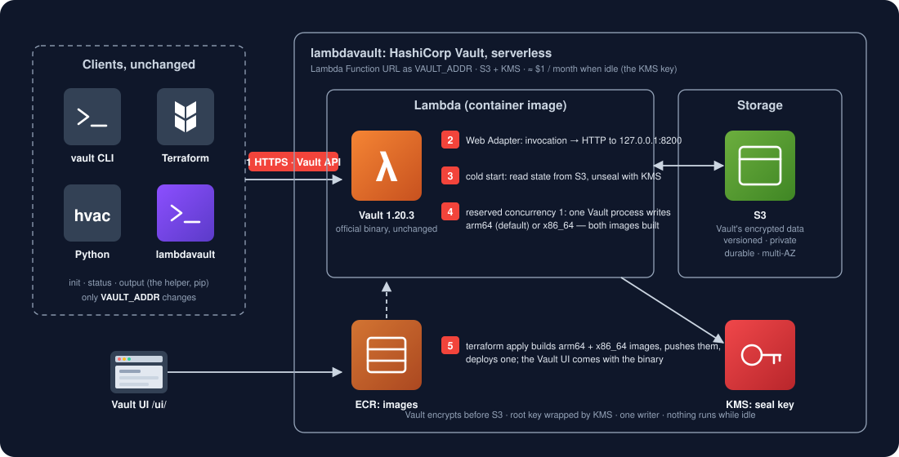

# lambdavault —— 真正 serverless 的 HashiCorp Vault

> 自己部署 **Vault** 意味着服务器全天开着（高可用要 3 台）；**HCP Vault** 每月约 $450 起。**lambdavault**
> 把官方 Vault 程序原样跑在 **AWS Lambda** 里，数据存在 **S3**，由 **KMS** 自动解封：闲置每月约 $1（KMS 密钥，按小时计费）。
> vault 命令行、hvac 和 Terraform 的 vault provider 照常使用，只改 `VAULT_ADDR`。

[English](README.md) · [兼容性报告](tests/compat/REPORT.md) · [任务](tests/compat/TASKS.md) · [更新记录](CHANGELOG.md)



| | 自己部署在 EC2 | HCP Vault Dedicated | lambdavault |
|---|---|---|---|
| 闲置费用 / 月 | 实例（高可用 3 台）、负载均衡、磁盘 | 约 $450（开发档）· 约 $1,150 起（Essentials） | 约 $1（KMS 密钥，按小时计费） |
| 运行的是 | 你实例上的 Vault 社区版 | HashiCorp 托管的 Vault 企业版 | Lambda 里的 Vault 社区版 1.20.3 |
| 存储 | 实例磁盘上的 Raft | HashiCorp 的云 | 你账号里的 S3（开版本控制），Vault 加密 |
| 解封 | 手动或 KMS | 托管 | KMS，每次冷启动由 Vault 自己解封 |
| 地址 | 你的负载均衡 | HCP | Lambda Function URL（HTTPS） |
| 客户端 | vault CLI、hvac、Terraform provider | 一样 | 一样，不用改 |
| 控制台 | Vault UI | Vault UI | Vault UI（`<vault_addr>/ui/`） |
| 兼容性 | — | — | [见报告](tests/compat/REPORT.md) |

## 为什么

大多数团队用 Vault 存静态密钥，每天交给 Terraform 和应用读几次。这只需要一个随时能访问的 Vault，不需要一个
一直在运行的 Vault。Lambda 只在有请求时运行 Vault；状态和密钥由 S3 和 KMS 保存。

## 原理

`src/server/Dockerfile` 是官方 `hashicorp/vault` 镜像加上 AWS Lambda Web Adapter：每次调用被转成一次发给
`127.0.0.1:8200` 上 Vault 的 HTTP 请求。Vault 的配置（`src/server/vault.hcl`）用 `s3` 存储后端，冷启动时从 S3
读取状态，用 KMS 自动解封。函数的保留并发是 1：s3 存储后端没有锁，所以永远只有一个
Vault 进程在写。Terraform 为 arm64 和 x86_64 都构建镜像、都推到 ECR，部署其中一个（`architecture`，默认 arm64）。

## 快速开始

### 1. 部署

需要 Terraform、正在运行的 Docker，以及 AWS CLI（用于登录 ECR）。

```bash
cp terraform/example.json terraform/my.json      # 改 aws_profile、region、name
terraform -chdir=terraform init
terraform -chdir=terraform apply -var-file=my.json
terraform -chdir=terraform output                 # vault_addr、ui_url
```

### 2. 初始化一次

```bash
export VAULT_ADDR=$(terraform -chdir=terraform output -raw vault_addr)
vault operator init -recovery-shares=1 -recovery-threshold=1   # 只打印一次 root token 和恢复密钥：两个都要保存好
export VAULT_TOKEN=<root token>
vault status
```

### 3. 像普通 Vault 一样使用

```bash
vault secrets enable -path=kvv2 kv-v2
vault kv put kvv2/app user=u password=p
vault kv get kvv2/app
```

```hcl
provider "vault" {
  address = "<vault_addr>"   # terraform output vault_addr
}

data "vault_kv_secret_v2" "app" {
  mount = "kvv2"
  name  = "app"
}
```

浏览器打开 `<vault_addr>/ui/` 就是 Vault UI。

任务 1 完成之前，Terraform 一次读很多密钥时请加 `-parallelism=1`：同一时刻只有一个 Vault 进程在处理请求，
并发的请求会收到 429。

## 兼容性

两边运行的是同一个 Vault 程序，所以报告验证的是：跑在 Lambda 上的 Vault 和普通 Vault 的回答完全一样。同样的
hvac 调用分别在 Docker 里的 Vault 1.20.3 和线上部署上执行，逐步比较。

```bash
LAMBDAVAULT_TOKEN=<token> python3 -m pytest tests -q --docker run --aws my.json   # Docker 里的 Vault vs 线上的 lambdavault
python3 -m pytest tests -q                               # 只跑回归测试
```

## 保证

| | 怎么做到 |
|---|---|
| **加密** | Vault 的 barrier 在写进 S3 之前加密所有数据（S3 另有 SSE-S3）；Vault 的根密钥由 KMS 加密 |
| **持久性** | S3（开版本控制：被覆盖的对象可以找回） |
| **只有一个写入者** | 保留并发 1：两个 Vault 进程永远不会同时使用存储 |
| **可用性** | Lambda、S3、KMS 都是区域级多可用区服务：没有要维护或打补丁的实例 |

## 适合谁

用 Vault 存静态密钥（KV）、用 token、策略和 userpass 等认证方式，每秒几个请求的团队。暂时不适合：很多并发调用者
（任务 1），以及 Raft、复制和企业版功能。迁到 Vault 集群见 MIGRATION.md。

## 目录

```
src/server/       Dockerfile（Vault + Lambda Web Adapter）、vault.hcl
client/           pip 包 lambdavault：status、output（可选的辅助工具）
terraform/        S3（开版本控制）、KMS 密钥（解封用）、ECR、Lambda、Function URL
tests/            回归测试；tests/compat/ Vault vs lambdavault、REPORT.md、TASKS.md
```

## 发版

每次 push 都跑测试。发版就是打 tag：改 `client/pyproject.toml` 和 `client/lambdavault/__init__.py` 里的版本号，
写 CHANGELOG，提交，然后 `git tag vX.Y.Z && git push --tags`。

---

**[Redefine AWS Serverless](https://github.com/topics/redefine-aws-serverless)** 系列的一部分：闲置也收费的
AWS 服务，用闲置 ≈ $0 的积木重做。MIT。Vault 是 HashiCorp 的商标；lambdavault 原样运行 Vault 社区版程序，
遵循其自身的许可证（BSL 1.1）。
