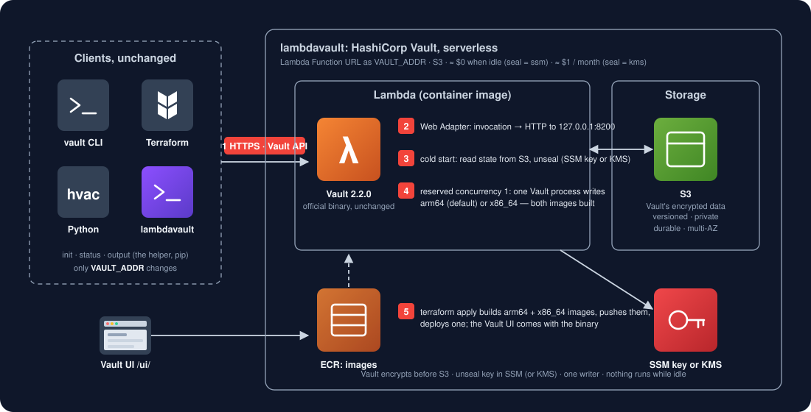

# lambdavault

**HashiCorp Vault, truly serverless: the official Vault binary on AWS Lambda, data in S3, the unseal key in SSM
Parameter Store, ≈ $0 when idle (or KMS auto-unseal, ≈ $1 a month).** Part of [IdleFree](https://cloudformer.github.io/).



The vault CLI, the Terraform vault provider, the UI and hvac are the clients — unchanged, only `VAULT_ADDR`
points at the Lambda (hvac: except `list`, which sends the HTTP method LIST that Lambda Function URLs refuse;
[task 5](https://github.com/cloudformer/lambdavault/blob/main/tests/compat/TASKS.md)). This package is the helper around a deployment:

```bash
pip install lambdavault
lambdavault status    # initialized / sealed / version / latency (address from terraform output)
eval "$(lambdavault output)"   # export VAULT_ADDR for the vault CLI
vault operator init -key-shares=1 -key-threshold=1   # once (seal = kms: -recovery-shares=1 -recovery-threshold=1)
vault kv get kvv2/app
```

Deploy with the Terraform module [`cloudformer/infra/aws//modules/lambdavault`](https://github.com/cloudformer/terraform-aws-infra/tree/main/modules/lambdavault),
which builds the server from this package (`lambdavault/server`, `lambdavault/proxy`).
Compatibility with a normal Vault: [REPORT.md](https://github.com/cloudformer/lambdavault/blob/main/tests/compat/REPORT.md).
